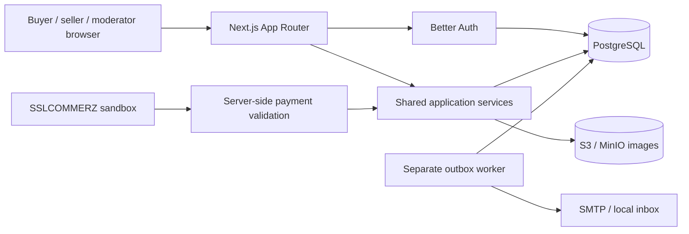

# Architecture

The system is one modular monolith, with a separate worker process using the same services and database. No Redis, search cluster, courier simulation, escrow or seller settlement backend is assumed. Route handlers under `/api/v1` call services also used by server-rendered pages. Better Auth owns `/api/auth`.

## Relational domain

`User → Session / Account / Verification` implements authentication. Profiles and seller onboarding live on User; users can both buy and sell. Roles are MEMBER, MODERATOR and ADMIN and cannot be submitted through signup/profile forms.

`Category → Listing → InventoryLot` models one batch per listing. Listing columns contain dimensions in mm, pieces per box, model/batch, finish, colour and composition. `Upload` belongs to a user and optionally to one listing. Common quantities/prices are relational fields, not arbitrary JSON.

`Order → Reservation` represents a single-item purchase request and its accepted order. PENDING is the purchase-request state; a separate duplicate PurchaseRequest table would add consistency work without information in v1. Title, unit, price, quantity and accepted pickup details are snapshotted. Historical records use restrictive foreign keys.

`SavedListing`, `SavedSearch`, `Wanted → WantedResponse → Listing`, `Conversation → Message`, `Block`, `Review`, `Notification`, `Report`, `AuditLog`, `PaymentAttempt → PaymentEvent / Promotion`, `Outbox` and database `RateLimit` support the remaining workflows. An ORDER report is a dispute; resolving it does not mutate inventory/payment.

## Inventory transaction

All inventory-mutating order operations take `SELECT ... FOR UPDATE` on the same InventoryLot row, then expire overdue holds inside that transaction. Each accepted order creates one uniquely constrained reservation. Available = total − reserved − sold. PostgreSQL CHECK constraints require each component to be nonnegative and reserved + sold ≤ total.

Acceptance checks current listing approval, buyer suspension, unit price snapshot, minimum/increment/whole-lot rules and current inventory. Stock is incremented in reserved only after these checks. Repeated accepts return the existing order. A unique pending buyer/listing index prevents duplicate pending requests; buyer/request-key uniqueness supports replay with payload consistency checks.

Completion requires READY and both timestamps. It marks the reservation CONSUMED while moving reserved → sold in the same locked transaction. Cancellation and expiry mark a HELD reservation released/expired and decrement once. Concurrent workers and buyer requests share the same lock discipline. Payment state is independent.

## Read privacy and rendering

Public listing DTOs explicitly select fields; email, phone, exact pickup address, auth records and moderation notes are not included. Private dashboards and conversations require current database-backed sessions; suspension is checked for every protected request. Exact pickup is released to order participants after acceptance.

Material images are sanitized to WebP before storage. Next Image is used with `unoptimized` for authenticated media because the standard optimizer does not forward session headers. The app has already generated thumbnails; this avoids an authorization-breaking image proxy and publicly cached private media. Hero imagery uses Next optimization. Public image delivery still checks current listing approval.

## Jobs

Outbox rows have unique deduplication keys, attempts, available time and processed time. Workers atomically claim by compare-and-set with a five-minute lease and bounded exponential retries. Notification deduplication is enforced in PostgreSQL. SMTP is at-least-once: if delivery succeeds and acknowledgement storage fails, a repeated SMTP delivery remains possible; a stable Message-ID is provided but is not a delivery guarantee.
